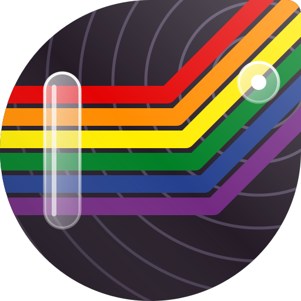

# Rustrx

A native Matrix client for Sailfish OS: a Silica interface on top of
[matrix-rust-sdk](https://github.com/matrix-org/matrix-rust-sdk), the library
behind Element X. The trustworthy and well maintained SDK does the heavy
lifting (sync, end-to-end encryption, key backup, device verification);
Rustrx is the Sailfish part around it.

The name is Rust and Matrix mushed together. The icon is a rainbow flag of
connecting fibres, because Rust.

## Why another one

It started the day a Jolla Phone 2026 arrived and Matrix was the first thing
that did not work. Sailtrix could not show the rooms properly, and its
project does not take LLM-written contributions. Hydrogen is a web wrapper,
and Element in App Support is not what you want on a Sailfish phone. So
Rustrx was built that evening.

Xmatic exists and has more
features. Rustrx does not try to compete with it or copy it: it is a
different, lean and clean take, tailored to one use case, texting and some
sharing of pictures and files. Rooms and people are kept apart, timestamps
are short (5m, 3h, 2d) and the fonts are larger. Calls and video chat are not
planned and will most likely never be. It also works well as the client for
a second account next to another one.

## What it does

- Log in with password or single sign-on, everything on one page, errors
  shown inline, nothing thrown away. "Create an account" opens the server's
  sign-up page. The session is kept: Rustrx starts in about a second, and if
  a server really ends the session, it goes back to the login page and says
  so.
- Native sliding sync where the server has it (matrix.org does), classic
  sync otherwise. Sync comes back by itself after a Wi-Fi drop.
- Rooms, People and Favs as three tabs, paged the way Jolla's Settings are.
  Invitations sit on top, the rest is ordered by activity. Rows show the
  avatar with the unread count as a badge, the last message, its age, a star
  for favourites and a lock for encrypted rooms. Long press to favourite,
  mark read or leave. Round avatars are a switch in Settings.
- "Add Room / Contact" in the pulley menu searches users and public rooms,
  takes a #alias or @user directly, and creates rooms and direct chats.
- A line under the tabs reminds you while the device is unverified or has
  no recovery key.
- Conversations with text in markdown, replies that quote what they answer,
  reactions, images, videos, audio, files, stickers, polls, locations and
  state events. Your own messages can be edited or removed; messages can be
  reported, copied as a link, or sent again when they failed. The header
  shows who is typing, "read by ..." shows read receipts. Drafts are kept
  per room.
- A push-up menu to take a photo (autofocus, a preview before sending), send
  a picture or file, or record a voice message (Ogg/Opus). Pictures go out upright and scaled down, with the
  composer text as caption. Pictures open in a viewer with pinch zoom and
  saving to Downloads.
- The share sheet: "Send to a room" from the gallery, the browser and other
  apps. `matrix:` and matrix.to links open in Rustrx.
- A page for each room: name, topic, address, encryption, favourite, low
  priority, members, invite, leave, and its own notification level.
- Notifications per room, updated in place, opening the room on a tap.
- Background mode (Settings > Notifications, off by default): when Rustrx is
  closed, a stand-in without a window stays connected, notifies within seconds
  even while the phone sleeps, and starts with the phone. A line in the events
  view shows it runs; tap it to open Rustrx, or quit it there.
- Device verification by emoji comparison, incoming or started from
  Settings (tested with nheko); restoring encrypted history with the
  recovery key; key backup; room key export and import.
- Settings for privacy (read receipts, typing, message text in
  notifications) and storage (sizes, clearing pictures and files).
- The cover shows unread counts and the connection state, with actions for
  search and the latest room with unread messages.

## How it is built

`core/` is a Rust crate that wraps matrix-rust-sdk behind three C functions
(`core/src/lib.rs`). Commands go in as JSON, events come back as JSON on one
callback. It is cross-compiled for aarch64 with `cargo-zigbuild`
(`core/build-aarch64.sh`), because the Rust shipped in the Sailfish SDK is too
old for the SDK, and placed at `lib/librustrx.so`.

The rest is an ordinary Sailfish application (qmake, `rpm/`, `qml/`,
`src/`). The C++ in `src/` is the bridge from the callback to the GUI thread,
plus the list models. It is built with the Sailfish Platform SDK and installs
the core next to its data in `/usr/share/harbour-rustrx/lib`.

Background mode is the same binary started by a systemd user unit
(`systemd/harbour-rustrx.service`) without a display connection: it loads
only `qml/Service.qml` (sync, notifications, the events view line). The
session bus name is the lock between the two. When the app opens, the
stand-in hands over and quits; when the app closes, it starts the unit
again. The stand-in never has a window, because lipstick 0.37.6 crashes
when a process exits after hiding or recreating its window.

## Status

0.4.0. From "let's build a client" to 0.2.0 in one evening, used daily on
the Jolla Phone 2026 since, and developed and maintained for the long run.
Tested against one account on one homeserver so far: SSO login is untested,
voice messages and pictures have not been checked from a second account, and
QR and OIDC login wait for a server that offers them (matrix.org has no
MSC4108 yet). Not yet there: spaces, threads, pinned messages, forwarding,
mention completion, QR verification. Push through UnifiedPush
([Foghorn](https://git.agnos.is/projectmoon/foghorn) and its Leghorn crate)
is planned as a lighter second option next to the stand-in.

## Install

RPMs are attached to the GitHub releases, for Sailfish OS 5.1 or later on
aarch64 (the core links against glibc 2.34; 5.0 and 4.6 ship older ones).
Rustrx bundles its core library, so it is an OpenRepos app, not a Jolla Store
one, and not a Chum one yet: Chum builds from source and Jolla's Rust is 1.75,
matrix-rust-sdk 0.19 needs 1.96. `core/Cargo.lock` is in the tree and the core
is built with `--locked` (rustc 1.99.1, zig 0.17.1, cargo-zigbuild).

On the first start Sailfish asks once for the permissions Rustrx uses
(internet, pictures, videos, music, documents, downloads, camera, audio,
microphone, user services). User services is what lets it start its
background stand-in.

## Authorship

The program was written by an LLM (Claude). The author directed it, decided
the design and tested every build on the phone. Every commit carries an LLMGD disclosure line; the
grading scheme is described at [moWerk/llmgd-specs](https://github.com/moWerk/llmgd-specs).

## Licence

GPL-3.0-or-later. matrix-rust-sdk is Apache-2.0.
