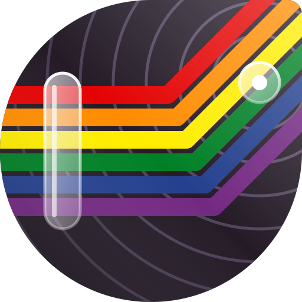
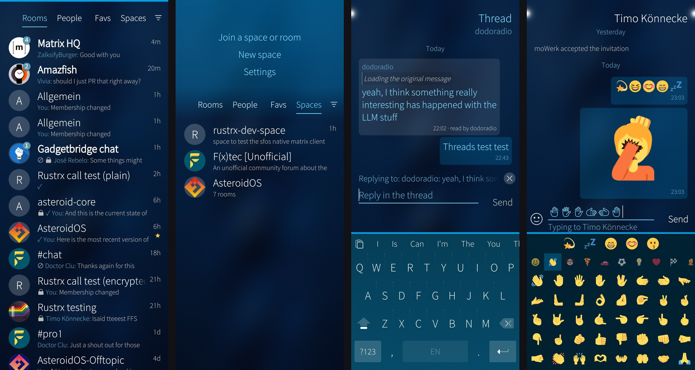

# Rustrx

A native Matrix client for Sailfish OS: a Silica interface on top of
[matrix-rust-sdk](https://github.com/matrix-org/matrix-rust-sdk), the library
behind Element X. The trustworthy and well maintained SDK does the heavy
lifting (sync, end-to-end encryption, key backup, device verification);
Rustrx is the Sailfish part around it.

The name is Rust and Matrix mushed together. The icon is a rainbow flag of
connecting fibres, because Rust.

## Why another one

It started the evening a Jolla Phone 2026 was unboxed, and Matrix was the
first thing that did not work. Sailtrix could not show the rooms properly,
and its project does not take LLM-written contributions. Hydrogen is a web
wrapper, and Element in App Support is not what you want on a Sailfish
phone. So Rustrx was built that evening.

What the author did not find that evening was Xmatic, a native Matrix client
that already existed and does more. Had it turned up, Rustrx would not
have been started. That says something about how scattered the places are where
Sailfish apps live. It also turned out to be lucky: Rustrx became a project
worth finishing, and its differences grew on their own, from following one
person's needs instead of looking at what other clients do. It is lean and
text first, made for texting and sharing some pictures and files. Rooms and
people sit apart by default, timestamps are short (5m, 3h, 2d), the room
list can be sorted, filtered and searched, and it runs on community ports
without sailfish-secrets. Since 0.4.4 it also has calls (unencrypted rooms for
now), threads, spaces with requests to join, and Twemoji with custom emoji and
stickers. It also works well as the client for a second account next to another one.

## What it does

- Log in with password or single sign-on, everything on one page, errors
  shown inline, nothing thrown away. "Create an account" opens the server's
  sign-up page. The session is kept: Rustrx starts in about a second, and if
  a server really ends the session, it goes back to the login page and says
  so.
- Native sliding sync where the server has it (matrix.org does), classic
  sync otherwise. Sync comes back by itself after a Wi-Fi drop.
- Rooms, People, Favs and Spaces as tabs, paged the way Jolla's Settings
  are, or, if you prefer, one "Chats" list with or without the Favs and
  Spaces tabs.
  Invitations sit on top. Rows show the avatar with the unread count as a
  badge that grows to the full count, one to three lines of the last
  message, its age, a star for favourites, and in front of the message a
  stop sign for muted rooms, a lock for encrypted ones and a check when
  your own last message was read. Long press to favourite, mark read or
  leave.
- A filter icon at the tabs: order by activity, unread first (most on top)
  or alphabetically; favourites on top and low priority at the bottom as
  switches; and a search that narrows the lists while you type, kept with
  a check mark if you want it to stay.
- "Add Room / Contact" in the pulley menu searches users and public rooms,
  takes a #alias or @user directly, and creates rooms and direct chats.
- A line under the tabs reminds you while the device is unverified or has
  no recovery key.
- Conversations with text in markdown, replies that quote what they answer,
  reactions, images, videos, audio, files, stickers, polls, locations and
  state events. Your own messages can be edited or removed; messages can be
  reported, copied as a link, shown as source, or sent again when they
  failed. A double tap replies. Messages sit in bubbles, without avatars:
  the sender's name is inside. The header shows the room's picture and who
  is typing, "read by ..." shows read receipts. Drafts are kept per room.
- Threads: replies in a thread are marked in the room and open their
  thread; a thread's page shows it alone with its own text field; "Reply
  in thread" in a message's menu; the room's threads, with the new
  replies marked, in its settings.
- Spaces: a tab with your spaces, each with its rooms and subspaces,
  joined or not; making spaces and rooms in them, adding and removing
  rooms, leaving a space alone or with its rooms. Who can join a room or
  space (invited only, ask to join, members of the space, anyone);
  requests to join with a notification and a list to accept, decline or
  ban; asking to join yourself; a preview before joining by address or
  link.
- Calls through Element Call in a WebView, with the SDK's widget driver
  behind it: incoming calls ring (VoIP ringtone, Answer, Decline), a
  running call shows in the room and the list. Unencrypted rooms only
  for now: Sailfish OS 5.2's Gecko 115 cannot do Element Call's
  encryption.
- Emoji as Twemoji pictures; an emoji picker in the keyboard's place
  behind a smiley button (your five most used on top, a swipe down closes
  it); custom emoji and stickers from Matrix image packs, "Add to my
  emoji" for one you see; reactions with any text.
- A push-up menu to take a photo (autofocus, a preview before sending), send
  a picture or file, or record a voice message (Ogg/Opus). Pictures go out
  upright and scaled down, with the composer text as caption, and show in
  the room at once with their upload progress. Pictures open in a viewer
  with pinch zoom and saving to Downloads.
- The share sheet: "Send to a room" from the gallery, the browser and other
  apps. `matrix:` and matrix.to links open in Rustrx.
- A page for each room: its picture (moderators can change it), name,
  topic, address, encryption, favourite, low priority, members, invite,
  leave, and its own notification level.
- Notifications per room, updated in place, opening the room on a tap, and
  one for each new invitation.
- Background mode (Settings > Notifications, off by default): when Rustrx is
  closed, a stand-in without a window stays connected, notifies within seconds
  even while the phone sleeps, and starts with the phone. A line in the events
  view shows it runs; tap it to open Rustrx, or quit it there.
- Device verification by emoji comparison, incoming or started from
  Settings (tested with nheko); restoring encrypted history with the
  recovery key; key backup; room key export and import.
- Settings for privacy (read receipts, who has read, typing, message text
  in notifications), appearance (avatars, preview lines, the tabs), one's
  own picture, storage (sizes, clearing pictures and files) and the
  logged-in devices. Portrait and landscape.
- The local store (messages and keys) is encrypted with a key kept in
  sailfish-secrets where that works; elsewhere, such as on community ports
  without it, as before. If a server ends the session, the store and the
  device are kept, so logging in again brings back keys and history.
- A debug log, on until 1.0 and off with a switch: if something goes wrong,
  Settings > Debug log shares it, so nobody has to make it happen again. It
  holds room and user IDs, never message texts or passwords.
- The cover shows unread counts and the connection state, with actions for
  search and the latest room with unread messages.

## How it is built

`core/` is a Rust crate that wraps matrix-rust-sdk behind three C functions
(`core/src/lib.rs`). Commands go in as JSON, events come back as JSON on one
callback. It is cross-compiled for aarch64 with `cargo-zigbuild`
(`core/build-aarch64.sh`), because the Rust shipped in the Sailfish SDK is too
old for the SDK, and placed at `lib/librustrx.so`.

The rest is an ordinary Sailfish application (qmake, `rpm/`, `qml/`,
`src/`). The C++ in `src/` is the bridge from the callback to the GUI thread,
plus the list models. It is built with the Sailfish Platform SDK and installs
the core next to its data in `/usr/share/harbour-rustrx/lib`.

Background mode is the same binary started by a systemd user unit
(`systemd/harbour-rustrx.service`) without a display connection: it loads
only `qml/Service.qml` (sync, notifications, the events view line). The
session bus name is the lock between the two. When the app opens, the
stand-in hands over and quits; when the app closes, it starts the unit
again. The stand-in never has a window, because lipstick 0.37.6 crashes
when a process exits after hiding or recreating its window.

## Status

0.4.4. From "let's build a client" to 0.2.0 in one evening, used daily on
the Jolla Phone 2026 since, and developed and maintained for the long run.
Tested with two accounts, on matrix.org and on tchncs.de (single sign-on
through its account service); QR and OIDC login wait for a server that
offers them (matrix.org has no MSC4108 yet). Not yet there: encrypted calls, pinned messages, forwarding,
mention completion, QR verification. Push through UnifiedPush
([Foghorn](https://git.agnos.is/projectmoon/foghorn) and its Leghorn crate)
is planned as a lighter second option next to the stand-in.

## Install

RPMs are attached to the GitHub releases, for Sailfish OS 5.1 or later on
aarch64 (the core links against glibc 2.34; 5.0 and 4.6 ship older ones).
Rustrx bundles its core library, so it is an OpenRepos app, not a Jolla Store
one, and not a Chum one yet: Chum builds from source and Jolla's Rust is 1.75,
matrix-rust-sdk 0.19 needs 1.96. `core/Cargo.lock` is in the tree and the core
is built with `--locked` (rustc 1.99.1, zig 0.17.1, cargo-zigbuild).

On the first start Sailfish asks once for the permissions Rustrx uses
(internet, pictures, videos, music, documents, downloads, camera, audio,
microphone, user services, secrets). User services is what lets it start
its background stand-in; secrets is where the store key is kept.

[Harpoon](https://github.com/JuhaniLehtimaeki/Harpoon) can install Rustrx
from this repository and keep it updated.

## Authorship

The program was written by an LLM (Claude). The author directed it, decided
the design and tested every build on the phone. Every commit carries an LLMGD disclosure line; the
grading scheme is described at [moWerk/llmgd-specs](https://github.com/moWerk/llmgd-specs).

## Licence

GPL-3.0-or-later. matrix-rust-sdk is Apache-2.0. The bundled Source Sans 3 Semibold
(`qml/fonts/`, by Adobe, unmodified) is under the SIL Open Font License 1.1. The emoji list
(`qml/emoji-data.js`) is generated from Unicode's emoji-test.txt, under the
[Unicode licence](https://www.unicode.org/terms_of_use.html). The emoji pictures
(`qml/twemoji/`) are [Twemoji](https://github.com/jdecked/twemoji) 17.0.3, unmodified:
graphics copyright Twitter, Inc. and other contributors and Jason Sofonia & Justine De
Caires and other contributors, licensed under
[CC-BY 4.0](https://creativecommons.org/licenses/by/4.0/) (`qml/twemoji/LICENSE-GRAPHICS`).
